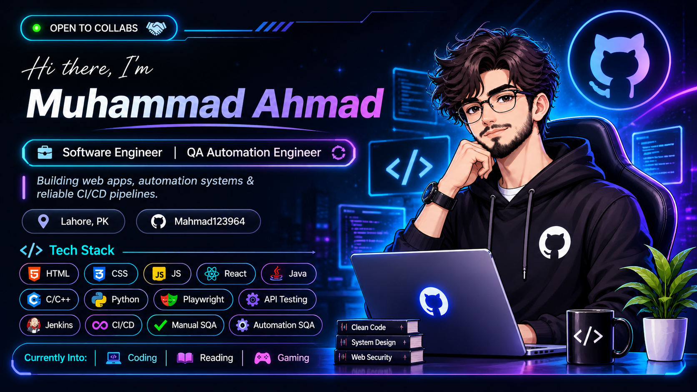

<h1 align="center">Muhammad Ahmad</h1>

  <strong>Software Engineer | QA Automation Engineer</strong>

  Building reliable software, modern web experiences, and automated quality pipelines.

  
  

👨‍💻 About Me
I'm a Software Engineering student and aspiring Software Engineer with a strong interest in web development, software quality, test automation, and CI/CD.

I enjoy turning ideas into practical software and making sure that the software I build is not only functional, but also reliable, maintainable, and user-friendly.

My current focus is on strengthening my development skills while growing professionally in QA Automation, API Testing, Playwright, Jenkins, and modern software engineering practices.
🚀 What I Do
🌐 Web Development	🧪 Software Quality
Responsive web interfaces	Manual Software Testing
React applications	Test Case Design
HTML, CSS & JavaScript	Functional Testing
Clean and reusable components	API Testing
Front-end project development	Bug Reporting & QA

🤖 Test Automation	⚙️ CI/CD & DevOps
Playwright	Jenkins
Automated UI Testing	Git & GitHub
End-to-End Testing	CI/CD Pipelines
Regression Testing	Docker
Automation Workflows	Automated Build & Test Workflows

🛠️ Tech Stack
💻 Web Development

☕ Programming Languages

🧪 Testing & QA

⚙️ Tools & Technologies

🎯 Current Focus
<table>
<tr>
<td width="50%">Web Development
React • JavaScript • Responsive UI

QA Automation
Playwright • UI Automation • E2E Testing

API Testing
API Validation • Functional Testing
</td>
<td width="50%">
CI/CD & Jenkins
Pipelines • Automated Builds • Testing

Software Engineering
Clean Code • Problem Solving • Development

DevOps Tools
Git • GitHub • Docker • Jenkins
</td>
</tr>
</table>🌱 Currently Learning
- Advanced React development
- Software Testing & QA Automation
- Playwright automation
- API testing
- Jenkins & CI/CD
- Docker
- Modern Software Engineering practices
🎮 Beyond Coding
When I'm away from development, I enjoy:
- 🎮 Gaming — Exploring games, mechanics, and interactive experiences.
- 📚 Reading — Learning new concepts and continuously expanding my knowledge.
- 💻 Coding — Building projects, experimenting with technologies, and solving problems.
📌 Featured Projects
🛒 Baroque E-Commerce Website
A React-based e-commerce project focused on building a modern shopping experience with reusable components and responsive UI.

Tech: React JavaScript HTML CSS
🧪 QA Automation Projects
Automation and testing projects focused on reliable test execution, UI automation, API testing, and regression testing.

Tech: Playwright API Testing CI/CD
⚙️ Jenkins & Docker
Practical CI/CD work involving Jenkins pipelines, Docker, automated builds, and software delivery workflows.

Tech: Jenkins Docker Git CI/CD
📊 GitHub

  <strong>Build • Test • Improve • Repeat</strong>

🤝 Let's Connect

  If you're interested in <strong>Software Engineering, Web Development, QA Automation, Testing, or CI/CD</strong>, feel free to connect.

  
  

✨ Build. Test. Improve. Repeat.

